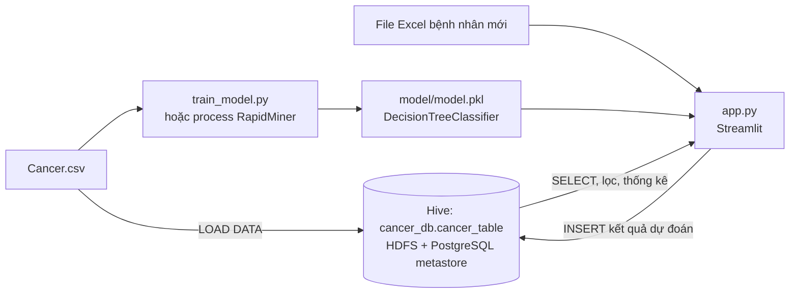

# Hệ thống dự đoán mức nguy cơ ung thư phổi trên Hadoop/Hive

Ứng dụng web (Streamlit) nhận hồ sơ bệnh nhân từ file Excel, dự đoán mức nguy cơ **Low / Medium / High**
bằng Decision Tree, lưu kết quả vào **Apache Hive** chạy trên Hadoop (Docker Compose), và cho phép lọc,
thống kê, vẽ biểu đồ trên dữ liệu đã lưu.

Đồ án môn học Big Data (nhóm 16, 2 thành viên, 12/2024 – 04/2025).

## Kết quả đánh giá mô hình

Chi tiết trong [`model_evaluation.ipynb`](Nhom16_HeThongDuDoanMacBenhUngThu/model_evaluation.ipynb).

| Cách đánh giá | Mô hình | Accuracy | F1-macro |
|---|---|---|---|
| Chia ngẫu nhiên 80/20 | Decision Tree | 1.000 | 1.000 |
| **Theo hồ sơ, 5-fold × 10 lần** | **Decision Tree (dùng trong app)** | **0.750 ± 0.072** | **0.736 ± 0.081** |
| Theo hồ sơ, 5-fold × 10 lần | Logistic Regression | 0.868 ± 0.063 | 0.860 ± 0.070 |
| Theo hồ sơ, 5-fold × 10 lần | Đoán lớp đông nhất (mốc) | 0.365 | 0.178 |

**Vì sao không báo 100%:** 1.000 dòng của bộ dữ liệu chỉ có **53 hồ sơ khác nhau**, mỗi hồ sơ lặp lại 10–70 lần.
Chia ngẫu nhiên thì mọi dòng test đều đã có y hệt trong tập train, nên 100% chỉ đo khả năng nhớ.
Đánh giá đúng là giữ mọi bản sao của một hồ sơ trong cùng một fold (`StratifiedGroupKFold`).
Trên hồ sơ chưa thấy, cây quyết định nhận ra High tốt nhưng hay nhầm Medium thành Low.

## Kiến trúc



## Cấu trúc thư mục

```text
.
├── docker/                         # Hadoop 2.7.4 + Hive 2.3.2 + PostgreSQL metastore
│   ├── docker-compose.yaml
│   ├── hadoop-hive.env
│   ├── hive-site.xml               # bật ACID để INSERT từng dòng
│   └── shared-data/Cancer.csv      # mount vào hive-server tại /data
├── Nhom16_HeThongDuDoanMacBenhUngThu/
│   ├── app.py                      # ứng dụng Streamlit
│   ├── Hive_server.ipynb           # tạo cancer_db, nạp Cancer.csv vào Hive
│   ├── train_model.py              # huấn luyện lại model không cần RapidMiner
│   ├── model_evaluation.ipynb      # đánh giá mô hình
│   ├── model/model.pkl
│   ├── model/DecisionTree.py       # operator "Execute Python" trong RapidMiner: huấn luyện
│   ├── ApplyModel.py               # operator RapidMiner: dự đoán
│   └── Web.py                      # operator RapidMiner: lưu model, khởi động Streamlit
├── Nhom16_HeThongDuDoanMacBenhUngThu.pdf   # báo cáo đồ án
└── requirements.txt
```

## Cách chạy

Cần Docker Desktop và Python 3.10+.

```bash
# 1. Khởi động Hadoop + Hive (lần đầu mất vài phút để tải image)
cd docker
docker compose up -d
# đợi khoảng 1-2 phút cho hive-server mở cổng 10000

# 2. Cài thư viện Python
cd ..
pip install -r requirements.txt

# 3. Tạo database và nạp dữ liệu: chạy toàn bộ Nhom16_HeThongDuDoanMacBenhUngThu/Hive_server.ipynb

# 4. Huấn luyện model cho đúng phiên bản scikit-learn trên máy, rồi mở ứng dụng
cd Nhom16_HeThongDuDoanMacBenhUngThu
python train_model.py
streamlit run app.py
```

Hive mặc định ở `localhost:10000`; đổi bằng biến môi trường `HIVE_HOST`, `HIVE_PORT`.

| Dịch vụ | Cổng trên máy |
|---|---|
| HiveServer2 (JDBC/Thrift) | 10000 |
| Hive Metastore | 9083 |
| HDFS NameNode | 8020 |
| NameNode web UI | 51070 |
| DataNode web UI | 51075 |

Tài khoản `hive/hive` của metastore chỉ dùng cho môi trường chạy thử trên máy cá nhân.

## Dữ liệu

`docker/shared-data/Cancer.csv` – 1.000 bệnh nhân, 21 chỉ số (ô nhiễm không khí, hút thuốc, ho ra máu, ...)
thang điểm 1–9 và nhãn `Level`. Nguồn:
[Cancer Patients and Air Pollution: A New Link (Kaggle)](https://www.kaggle.com/datasets/thedevastator/cancer-patients-and-air-pollution-a-new-link).
Dữ liệu phục vụ minh họa kỹ thuật; ứng dụng không dùng để chẩn đoán thật.

## Công nghệ

Python (pandas, scikit-learn, PyHive), Streamlit + Altair, Apache Hive 2.3 (HiveQL, bảng ORC transactional),
Hadoop HDFS 2.7, PostgreSQL (metastore), Docker Compose, RapidMiner.

## Cập nhật sau khi kết thúc môn học

- Thêm notebook đánh giá mô hình theo hồ sơ và bảng kết quả ở trên.
- Sửa ánh xạ nhãn: model xuất từ RapidMiner mã hóa `0 = Low, 1 = High, 2 = Medium`, bản cũ hiển thị nhầm High thành Medium. Model mới trả thẳng nhãn chữ.
- Ép kiểu số cho mọi cột trước khi `INSERT` vào Hive, để nội dung ô Excel không thể chèn lệnh SQL.
- Cấu hình kết nối Hive qua biến môi trường; gộp cấu hình Docker (trước ở repo `Hive`) vào thư mục `docker/`.
- `Web.py` gọi Streamlit không qua shell; đổi `Cancer Prediction.py` thành `app.py`.
